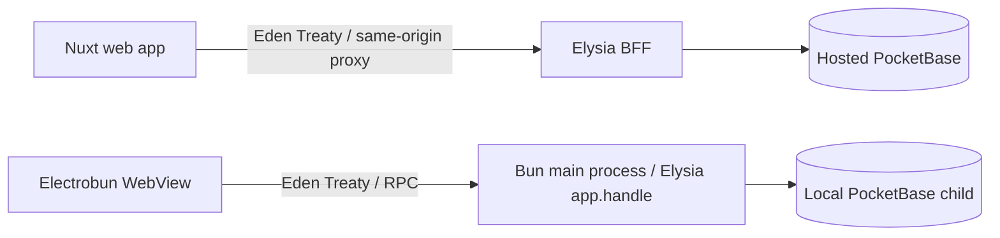
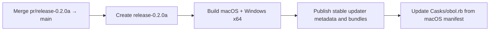

# Obol

Obol is a personal cash-flow ledger and forecaster. It reconstructs past balances from realized transactions and projects future balances from pending transactions, invoices, and recurrences.

The desktop app runs locally: an Electrobun window hosts the Nuxt interface, while Bun starts the Elysia API and a bundled PocketBase process. No deployed server or Docker installation is required. The hosted web stack remains available for people who prefer a server.

## Features

- A daily balance calendar previews projected cash for each day alongside the forecast trajectory.
- A transaction ledger with structured search and filters, matching summary totals, lifecycle details, sorting, and CSV export.
- Accounts, credit cards, invoices, budgets, projects, and recurring transactions.
- Credit-card budgets use purchase dates; cash-flow projections account for invoice due dates and partial payments.
- A persistent local desktop profile, separated from hosted PocketBase data.
- Packaged desktop builds check for stable updates and download available bundles in the background.

## How it works

The hosted and desktop modes share the same Elysia use cases and PocketBase repositories:



In desktop mode, the WebView sends typed API requests over Electrobun RPC. The main process dispatches them to the existing Elysia app; the UI does not call PocketBase or a network-facing server.

## Local data

- On first launch, create a local name/email/password profile. Later launches require that password to unlock Obol.
- The password verifier is stored in `local_profile.json`; PocketBase's internal superuser credential is derived from the password and reconciled before the local service starts.
- Upgrading a 0.1.0 profile preserves its PocketBase records and repairs the internal superuser login during first-time profile setup.
- Desktop data lives in the current user's application-data directory under `copland.obol`; development uses the isolated identity `copland.obol.eb-dev`.
- Desktop data is not imported from or synchronized with the hosted `db/pb_data` volume.
- PocketBase files are not encrypted by the app login. Use macOS FileVault or Windows BitLocker for at-rest protection.
- Desktop builds pin PocketBase 0.40.6 and verify downloaded binary checksums.

## Releases
Obol 0.2.0 is published without an in-app updater. The 0.2.0a release PR `pr/release-0.2.0a` repairs the PocketBase migrations path that blocked the 0.2.0 macOS app and adds automatic update checks and background downloads, followed by a user-controlled restart to install.

Because 0.2.0 cannot update itself, users must install 0.2.0a manually once. Later stable releases can update in-app. Merging the 0.2.0a PR into `main` creates `release-0.2.0a` and publishes Electrobun update metadata/full bundles alongside the platform installers.

macOS builds are ad-hoc signed, not Developer ID signed or notarized. Windows installers are unsigned and may prompt SmartScreen.



Install the current public release with Homebrew:

```sh
brew tap caiofasoares/obol https://github.com/CaioFaSoares/Obol
brew install --cask obol
```

## Documents

| Document | Contents |
| --- | --- |
| [`docs/canon.md`](docs/canon.md) | Product rules, data model, operations, and current status. |
| [`docs/arquitetura.md`](docs/arquitetura.md) | Runtime modes, module boundaries, and API flow. |
| [`docs/decisions/`](docs/decisions/log.md) | Accepted architecture decisions. |
| [`docs/epics/`](docs/epics/) | E001 ledger/desktop, E002 use-case dispatch, E003 dashboard, E004 Windows packages, and E005 in-app updater. |
| [`docs/handovers/`](docs/handovers/) | Current-state handoff for design work. |
| [`AGENTS.md`](AGENTS.md) / [`CONTEXT.md`](CONTEXT.md) | Repository rules and project vocabulary. |

## Running

Enter the Nix environment:

```sh
nix develop
```

From that shell, install dependencies once and start the local desktop app:

```sh
(cd app && npm ci)
(cd server && bun install --frozen-lockfile)
(cd desktop && bun install --frozen-lockfile)
(cd desktop && bun run eb:dev)
```

Build and verify a packaged app:

```sh
(cd desktop && bun run eb:build)
(cd desktop && bun run eb:verify)
```

## Hosted development

From the Nix shell, configure the PocketBase superuser credentials and start the Compose stack:

```sh
cp .env.example .env
docker compose up -d --build
```

The web app is available at `http://localhost:13000`; PocketBase Admin is at `http://localhost:13090/_/`.
